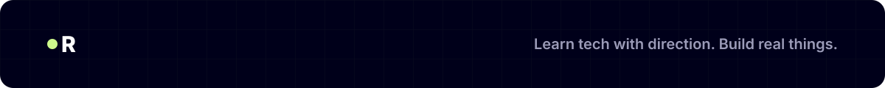

  

  
  
  

  <b>Computer Science student building a career in cybersecurity.</b> 
  Training with CS50x and TryHackMe, working toward CompTIA Security+, and shipping real software along the way.

 

I'm a Computer Science student at Southern New Hampshire University, and cybersecurity is the career I'm building. I'm doing it in order: computer science fundamentals through Harvard's CS50x, hands-on labs on TryHackMe, and CompTIA Security+ as my first certification.

Before security, I built and shipped full-stack web apps for real small businesses, with admin logins, payments and databases. That work showed me how the systems I want to protect are actually built.

I also work as a Manager on Duty in large-scale transportation operations, where I lead teams and make decisions under pressure. And as the founder of RuutDev, I create bilingual tech content.

  &nbsp;&nbsp;<b>Focus:</b> Cybersecurity 
  &nbsp;&nbsp;<b>Education:</b> B.S. Computer Science, SNHU (expected 2027) 
  &nbsp;&nbsp;<b>Looking for:</b> my first role in cybersecurity 
  &nbsp;&nbsp;<b>Location:</b> Kissimmee, Florida. Open to remote 
  &nbsp;&nbsp;<b>Languages:</b> Spanish (native), English (professional)

 

 

 

  
  
  
  

 

  
  
  

 

  

